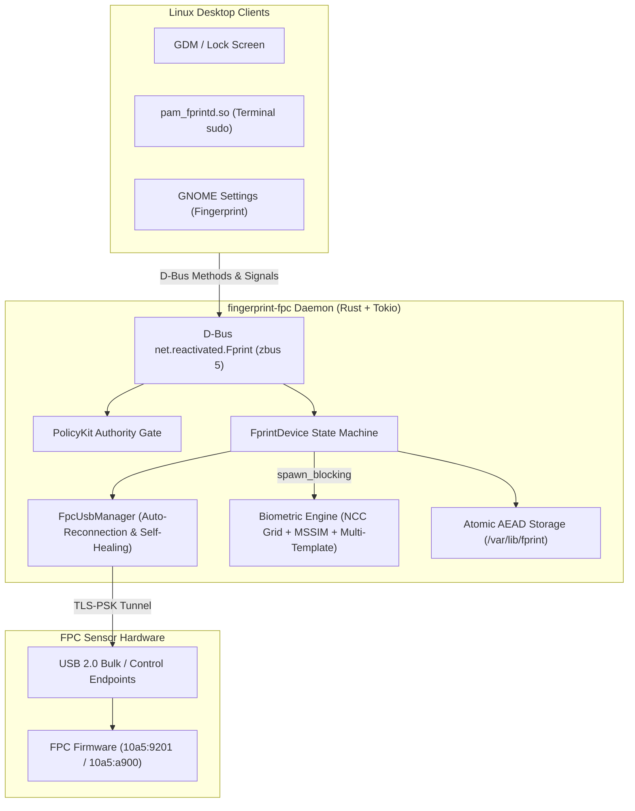

# fingerprint-fpc (Linux FPC 指纹驱动守护进程)

<div align="center">

[](https://www.rust-lang.org/)
[](LICENSE)
[](https://github.com/vrolife/fingerprint-ocv)
[](https://github.com/vrolife/fingerprint-ocv)
[](https://gitlab.freedesktop.org/libfprint/fprintd)
[](https://wiki.archlinux.org/title/Fprint)

**High-reliability, self-healing, memory-safe Linux D-Bus driver for FPC fingerprint sensors.**  
**适用于小米 / RedmiBook 等笔记本 FPC 指纹传感器的高可用、自愈型、内存安全 Linux 原生驱动守护进程。**

[English](#english) | [简体中文](#简体中文)

</div>

---

<a name="english"></a>
## 🇬🇧 English

`fingerprint-fpc` is a modern, pure-Rust reimplementation of the reverse-engineered `fingerprint-ocv` driver for **Fingerprint Cards AB (FPC)** sensors (USB IDs `10a5:9201` and `10a5:a900`), commonly found in Xiaomi and RedmiBook laptops.

It strictly adheres to the [Google Open Source Rust Style Guide](https://google.github.io/styleguide/rustguide.html) and serves as a drop-in replacement for system `fprintd` (`net.reactivated.Fprint`), delivering crash-proof memory safety, hardware-tunnel TLS-PSK encryption, and suspend-resume self-healing.

### ✨ Key Features

* **🛡️ High-Availability (HA) & Hardware Self-Healing**:
  * **Dynamic Lifecycle Supervisor (`FpcUsbManager`)**: Continuously monitors USB bus state with exponential backoff auto-reconnection.
  * **Seamless Suspend / Resume Recovery**: Fixes the ubiquitous driver death when laptops wake up from sleep (S3 / S0ix) and reset the USB bus (`rusb::Error::NoDevice`). Automatically re-establishes the hardware TLS-PSK session on the next authentication request without restarting services.
  * **Race-Condition-Proof Boot**: Starts cleanly even if the sensor controller has not finished USB bus enumeration during boot.
* **⚡ Structured Asynchronous Concurrency & Worker Fairness**:
  * Built on **Tokio** and **zbus 5** — zero raw C `libdbus-1` callback bugs or continuation engine crashes.
  * **Heavy Computation Decoupling**: Heavy image enhancement, 2-stage rotation/translation grid alignment (NCC), and structural similarity (MSSIM) are completely offloaded to `tokio::task::spawn_blocking`, preventing Tokio worker thread starvation and eliminating D-Bus latency jitter.
  * **Lock-Free Instant Cancellation**: Replaced mutex contention during task abortion with atomic `cancel_token` (`Arc<AtomicBool>`). Disarming sensor commands are dispatched asynchronously, eliminating D-Bus reply lag.
* **🎯 Precision Biometric Engine & Anti-Debounce**:
  * **Pure Rust Image Pipeline**: Completely eliminated the 1GB+ OpenCV dependency (SIFT, BFMatcher, RANSAC). Replaced brittle Homography stitching with a robust multi-template strategy (up to 5 verified scan templates per finger).
  * **Calibrated FAR / FRR Safety Margins**: Baseline threshold set to `0.38`. Added secondary multi-template correlation checks for marginal scores (`[0.38 .. 0.44)`) and enforced a minimum of 28 valid ridge blocks, drastically reducing False Acceptance Rate (FAR).
  * **Anti-Debounce & Finger Release Detection**:
    * Implemented `EnrollStageResult::DuplicatePress` (>0.95 similarity) to prompt users to reposition fingers and guarantee diverse spatial coverage.
    * Added `poll_finger_up` hardware event detection to enforce lifting fingers between enrollment stages.
* **🔐 Hardware-Anchored Cryptography & Storage Hardening**:
  * **Strict POSIX Permissions**: Fixed upstream `umask(0600)` inversion (which created world-writable `0066` files) with enforced `0077` umask and explicit `0700`/`0600` permission bits.
  * **PolicyKit Authorization Gate**: Enforced asynchronous Polkit verification on sensitive D-Bus endpoints (`EnrollStart`, `DeleteEnrolledFingers`, `DeleteEnrolledFinger`) via `net.reactivated.fprint.device.*` actions, closing local privilege escalation vulnerabilities.
  * **Hardware-Bound AEAD Storage**: Encrypted biometric templates on disk (`/var/lib/fprint/*.bin`) using ChaCha20-Poly1305 with keys derived from the hardware TLS-PSK. All write operations use temporary files, `sync_all`, and atomic replacement.
* **💤 D-Bus On-Demand Activation & Power Efficiency**:
  * Ships with `/usr/share/dbus-1/system-services/net.reactivated.Fprint.service` and `--idle-timeout 30`.
  * Releases USB handles and gracefully shuts down after 30 seconds of inactivity, launching in under 50ms upon authentication requests.
* **📦 Turnkey Delivery & Multi-Distro Packaging**:
  * One-click installation and clean rollback scripts (`install.sh`, `uninstall.sh`).
  * Ready-to-use Debian/Ubuntu `.deb`, RedHat/Fedora `.rpm`, Arch Linux `PKGBUILD`, and generic `.tar.gz` packaging pipelines.

---

### 🏛️ Architecture Overview



---

### 📦 Prerequisites & System Dependencies

On Ubuntu / Debian:
```bash
sudo apt update && sudo apt install -y \
    build-essential \
    pkg-config \
    libusb-1.0-0-dev \
    libssl-dev \
    libpam-fprintd \
    fprintd
```

On Fedora / RHEL:
```bash
sudo dnf install -y \
    gcc \
    pkgconf-pkg-config \
    libusb1-devel \
    openssl-devel \
    fprintd-pam
```

On Arch Linux:
```bash
sudo pacman -S --needed \
    base-devel \
    pkgconf \
    libusb \
    openssl \
    fprintd
```

---

### 🚀 Quick Start & Installation

#### Option A: One-Click Turnkey Script (Recommended)
```bash
git clone https://github.com/vrolife/fingerprint-fpc.git
cd fingerprint-fpc

# Automatically compiles release binary, installs systemd unit,
# sets up D-Bus on-demand activation, masks stock fprintd, and configures PAM:
sudo ./scripts/install.sh
```

#### Option B: Debian / Ubuntu (`.deb`) Package
```bash
./scripts/package-deb.sh
sudo dpkg -i dist/fingerprint-fpc_1.0.0_amd64.deb
```

#### Option C: Arch Linux (`makepkg`)
```bash
cd packaging/arch
makepkg -si
```

#### Option D: Portable Generic Tarball
```bash
./scripts/package-tar.sh
cd dist && tar -xzf fingerprint-fpc-*.tar.gz
cd fingerprint-fpc-*/ && sudo ./install.sh
```

---

### 🧪 Verification & Usage

```bash
# 1. Verify device is recognized
fprintd-list $USER

# 2. Enroll right index finger (follow prompts to place & lift finger)
fprintd-enroll -f right-index-finger $USER

# 3. Test verification
fprintd-verify $USER

# 4. Test PAM authentication in terminal
sudo ls
```

---

### 📦 Distribution Packaging Pipeline

To produce distribution packages for all platforms locally:

```bash
./scripts/package-all.sh
```

Generated artifacts are placed in `dist/`:
* `dist/fingerprint-fpc_1.0.0_amd64.deb` (Debian, Ubuntu)
* `dist/fingerprint-fpc-1.0.0-linux-x86_64.tar.gz` (Generic Portable)
* `dist/fingerprint-fpc-1.0.0-1.x86_64.rpm` (Fedora, openSUSE — when `rpmbuild` installed)
* `dist/fingerprint-fpc-1.0.0-1-x86_64.pkg.tar.zst` (Arch Linux — when `makepkg` installed)

---

### 🧹 Clean Uninstallation & System Rollback

```bash
# Cleanly remove driver, restore stock fprintd, and keep biometric data
sudo ./scripts/uninstall.sh

# Or completely wipe all enrolled biometric templates
sudo ./scripts/uninstall.sh --purge
```

---

### 📋 Documentation & Changelog

* 📋 [Release Changelog](CHANGELOG.md) | [更新日志](CHANGELOG.zh-CN.md)
* 📜 [Software License](LICENSE) (GPL-3.0-or-later)

---

<a name="简体中文"></a>
## 🇨🇳 简体中文

`fingerprint-fpc` 是一款现代化、纯 Rust 开发的开源 Linux 指纹驱动守护进程，专用于 **Fingerprint Cards AB (FPC)** 芯片（USB ID：`10a5:9201` 和 `10a5:a900`），广泛应用于小米和 RedmiBook 全系列轻薄笔记本。

本项目遵循 [Google 开源 Rust 编程规范](https://google.github.io/styleguide/rustguide.html)，作为系统原生 `fprintd` (`net.reactivated.Fprint`) 的无缝替代品（Drop-in Replacement），彻底杜绝内存越界崩溃，提供硬件 TLS-PSK 加密通信以及合盖睡眠唤醒自愈能力。

### ✨ 核心功能亮点

* **🛡️ 高可用（HA）架构与硬件状态机自愈**：
  * **动态生命周期管理器 (`FpcUsbManager`)**：实现对 USB 总线状态的动态感知与指数退避重连机制（Backoff Reconnect）。
  * **休眠唤醒（Suspend / Resume）自愈**：彻底解决原项目在笔记本合盖睡眠唤醒（S3/S0ix）后 USB 重置导致驱动假死的通病。遇到总线断线（`rusb::Error::NoDevice`）时自动失效旧会话，当下一次验证请求到达时自动扫描总线重新协商 TLS-PSK 硬件隧道。
  * **容错启动**：若系统开机时硬件尚未完成总线枚举，D-Bus 接口照常注册就绪，首个业务请求到来时自动按需连接硬件，消除开机竞态启动失败。
* **⚡ 结构化异步并发与调度公平性**：
  * 完全基于 **Tokio** 与 **zbus 5** 现代化异步体系重构，彻底废弃裸 C `libdbus-1` 回调与不稳定协程引擎。
  * **重度计算隔离**：将图像增强预处理、2x 双线性插值、粗细两阶段网格搜索（NCC）及滑动窗口 MSSIM 相似度比对完整剥离至 `tokio::task::spawn_blocking` 独立线程池中执行，彻底杜绝 Tokio 异步调度器延迟抖动。
  * **无锁化瞬时任务取消**：使用原子布尔标记 `cancel_token`（`Arc<AtomicBool>`）替代传统互斥锁死等机制。外部取消时毫秒级无锁返回，传感器反布防指令交由后台独立协程异步调度，消除 D-Bus 接口响应卡顿。
* **🎯 精准生物识别引擎与录入防抖安全防线**：
  * **纯 Rust 图像识别管线**：彻底剥离上 GB 的臃肿 OpenCV 依赖（SIFT、BFMatcher、RANSAC）。放弃在微型低分辨率传感器上极易失效的单应性大图拼合，改用稳健的多模板（每指最多 5 个独立模板）策略。
  * **双层误识率（FAR）安全边界加固**：将基准判定阈值校准提升至 `0.38`；引入二级置信度防线（单模板 `>= 0.44` 高置信直通，`[0.38 .. 0.44)` 边缘区间强制要求至少有两个模板给出正向相关度，且要求至少 28 个有效纹线结构块），大幅降低误认他人手指风险。
  * **录入防抖与物理离开检测**：
    * 实现 `EnrollStageResult::DuplicatePress`（>0.95 相似度）防抖拦截，提示用户微调移动手指，确保多模板覆盖不同的指腹与边缘区域；
    * 新增 `poll_finger_up` 硬件事件检测，录入成功后强制轮询等待手指抬起，防止同一次按压连发。
* **🔐 硬件锚定密码学与系统安全加固**：
  * **权限掩码取反漏洞修复**：彻底修复原 C++ 版本中 `umask(0600)` 导致的生成文件为 `0066`（全局可读写）的严重漏洞，强制统一实施 `0077` umask 以及显式 `0700`/`0600` POSIX 权限位。
  * **PolicyKit 异步鉴权网关**：对敏感 D-Bus 接口（`EnrollStart`、`DeleteEnrolledFingers`、`DeleteEnrolledFinger`）强制接入 Polkit 鉴权（`net.reactivated.fprint.device.*`），严防普通本地用户未提权录入或篡改管理员指纹。
  * **硬件锚定 AEAD 存储**：模板采用基于硬件 TLS-PSK 派生的密钥结合 ChaCha20-Poly1305 加密落盘（`/var/lib/fprint/*.bin`）。所有写入均采用临时文件 + `sync_all` + 原子替换 rename，掉电绝不损坏数据。
* **💤 D-Bus 按需激活（Bus Activation）与极致省电**：
  * 内置 `/usr/share/dbus-1/system-services/net.reactivated.Fprint.service` 描述符，配合 `--idle-timeout 30`。
  * 闲置超时自动释放 USB 设备并退出，有验证请求时 50 毫秒内瞬间拉起，兼顾极低待机功耗。
* **📦 全自动交钥匙交付与多发行版生态**：
  * 一键安装与系统回滚脚本（`install.sh`、`uninstall.sh`）。
  * 原生支持 Debian/Ubuntu `.deb`、RedHat/Fedora `.rpm`、Arch Linux `PKGBUILD` 以及便携绿色 `.tar.gz` 自动化打包。

---

### 🚀 快速开始与安装指南

#### 方式 A：一键交钥匙脚本（推荐）
```bash
git clone https://github.com/vrolife/fingerprint-fpc.git
cd fingerprint-fpc

# 自动编译 Release 二进制、配置 systemd、注册 D-Bus 按需激活、屏蔽原生冲突 fprintd 并开启 PAM 支持：
sudo ./scripts/install.sh
```

#### 方式 B：Debian / Ubuntu (`.deb`) 安装包
```bash
./scripts/package-deb.sh
sudo dpkg -i dist/fingerprint-fpc_1.0.0_amd64.deb
```

#### 方式 C：Arch Linux (`makepkg`)
```bash
cd packaging/arch
makepkg -si
```

#### 方式 D：便携绿色压缩包
```bash
./scripts/package-tar.sh
cd dist && tar -xzf fingerprint-fpc-*.tar.gz
cd fingerprint-fpc-*/ && sudo ./install.sh
```

---

### 🧪 验证与日常使用

```bash
# 1. 验证设备是否正常识别
fprintd-list $USER

# 2. 录入右手食指（按终端提示按压并抬起手指）
fprintd-enroll -f right-index-finger $USER

# 3. 测试指纹验证
fprintd-verify $USER

# 4. 测试终端 sudo 鉴权
sudo ls
```

---

### 🧹 完整卸载与系统回滚

```bash
# 干净卸载驱动并解封恢复系统自带 fprintd（保留已录入指纹数据）
sudo ./scripts/uninstall.sh

# 或彻底抹除全部生物特征数据
sudo ./scripts/uninstall.sh --purge
```

---

### 📋 文档与日志

* 📋 [更新日志 (CHANGELOG)](CHANGELOG.zh-CN.md) | [English Changelog](CHANGELOG.md)
* 📜 [软件开源协议](LICENSE) (GPL-3.0-or-later)
